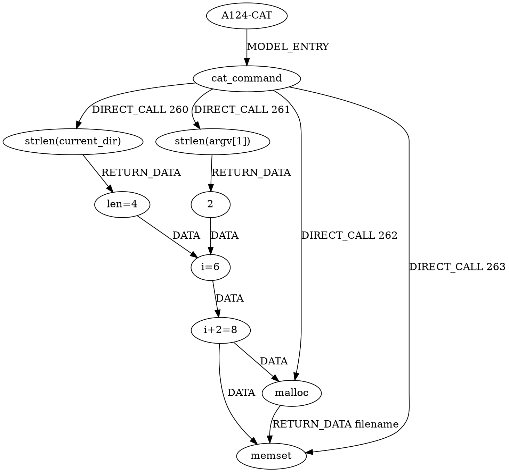

# 第124批独立验收 · 长度、读取与有界复制

**C08裁定 `PASS_PENDING_LOCAL`，本批无新增退回。** 固定time上的15个库函数案例、一个 shell 长度消费例及11个历史纠正案例均已复算。下文补齐消费例在图中的标识、复制表的源字符串和证据分类。R123-01 的独立裁定见[同提交的历史回执](CORE-USER-LIBC-STRING-LENGTH-COPY-124-D00-123-review.md)。[175号合同](https://github.com/08822407d/MyOS2/blob/88968361c2fa/agent-workspace/lead/MYOS2-LEAD-002/175-user-libc-string-length-copy-restart-contract.md) · [PR17 #7073604860](https://github.com/08822407d/MyOS2/pull/17#issuecomment-7073604860) · [PR17 #7073841635](https://github.com/08822407d/MyOS2/pull/17#issuecomment-7073841635)

## 从输入字节重算

模型给定8字节 unsigned long、小端、充分可读的同一对象和有效指针。C08 按源码的前导对齐循环、无符号64位减法和按位运算，独立重建每个整字、候选掩码、实际确认的字节序列和返回结果。B把指针转换及比较按给定机器的地址次序解释；这些例子不构成通用C可移植性或真实机器读取的认证。B的“整字读取字节数”仅统计整字载入，另列逐字节确认。[机器表](https://github.com/08822407d/MyOS2/blob/00c0228c52b8/agent-workspace/results/MYOS2-LEAD-002-CORE-CHECK-01/user-libc-string-length-copy-124/facts-and-boundaries.yaml) · [strlen](https://github.com/08822407d/MyOS2/blob/a039d9803ade/myinitramfs/mylib/myglibc/string/strlen.c#L29-L104) · [__strnlen](https://github.com/08822407d/MyOS2/blob/a039d9803ade/myinitramfs/mylib/myglibc/string/strnlen.c#L32-L159)

| 场景（按原case顺序） | 独立结果 |
|---|---|
| A124-01～04 | 长度0、1、2、10。整字载入次数1、0、1、2。第二例首地址模8为5，前导在下标1遇零。 |
| B124-01～06 | 预算0、2、3、5、9、10，分别返回0、2、3、3、9、9。整字载入次数0、1、1、1、2、2。A和B合计11次整字值和两种掩码逐个匹配。 |
| B124-06 的第一整字 | 八个0x81的字节均非零。A掩码为0，B掩码为0x8080808080808080，后者触发八次确认。第二整字才在总下标9确认首个零。 |
| C124-01～05 | 从同一初始目的字节0x23重新计算每次写入。size依次0、2、3、3、0；补零区间依次为空、空、空、[3,5)、[0,4)。五次memcpy的长度均等于size，包括两次零长度调用，返回均为目的起点。 |

[VERIFIED myinitramfs/mylib/myglibc/string/strlen.c::STRLEN]
```c
		longword = *longword_ptr++;

		if (((longword - lomagic) & ~longword & himagic) != 0)
```

[固定源码 74–76](https://github.com/08822407d/MyOS2/blob/a039d9803ade/myinitramfs/mylib/myglibc/string/strlen.c#L74-L76)

[VERIFIED myinitramfs/mylib/myglibc/string/strnlen.c::__strnlen]
```c
		longword = *longword_ptr++;

		if ((longword - lomagic) & himagic)
		{
```

[固定源码 116–119](https://github.com/08822407d/MyOS2/blob/a039d9803ade/myinitramfs/mylib/myglibc/string/strnlen.c#L116-L119)

B124-02用预设的24字节对象，首个NUL在下标3，maxlen=2。源码模型装入一个整字、复核下标0至3，在返回前夹到2。返回长度、已取整字的宽度和逐字节确认的数量是三个独立字段。C124-03的源为“cat”、n=3，只写入63 61 74；C124-04的n=5，先填目的[3,5)为零，再复制[0,3)的三个源字节。这些归属与函数最后返回的指针均能由固定源码解释。[最终夹取](https://github.com/08822407d/MyOS2/blob/a039d9803ade/myinitramfs/mylib/myglibc/string/strnlen.c#L153-L159) · [strncpy 三个调用点](https://github.com/08822407d/MyOS2/blob/a039d9803ade/myinitramfs/mylib/myglibc/string/strncpy.c#L26-L33) · [memcpy 返回](https://github.com/08822407d/MyOS2/blob/a039d9803ade/myinitramfs/mylib/myglibc/string/memcpy.c#L54-L60)

## C08 的两项使用补记

**A124-CAT。** 机器件已有case_id，原正文第81行给出两次 strlen 的实参与结果，原DOT只收录了26个编号案例。以此段作为该消费例的同名图补件。参数给定 current_dir="/bin"、argv[1]="hi"。len=4、i=6、请求大小8；malloc及随后的memset仅在源码请求层记录，目的区域实际可用性另有前提。[原正文](https://github.com/08822407d/MyOS2/blob/00c0228c52b8/agent-workspace/results/MYOS2-LEAD-002-CORE-CHECK-01/user-libc-string-length-copy-124/libc-string-length-copy.md#L79-L81) · [原机器件](https://github.com/08822407d/MyOS2/blob/00c0228c52b8/agent-workspace/results/MYOS2-LEAD-002-CORE-CHECK-01/user-libc-string-length-copy-124/facts-and-boundaries.yaml#L426-L437)

[VERIFIED myinitramfs/myshell/myshell.c::cat_command]
```c
	len = strlen(current_dir);
	i = len + strlen(argv[1]);
	filename = malloc(i + 2);
	memset(filename, 0, i + 2);
```

[固定源码 260–263](https://github.com/08822407d/MyOS2/blob/a039d9803ade/myinitramfs/myshell/myshell.c#L260-L263)



**C124 的源数据。** 正文“源”列与机器件 source 字段实际填的是源码位置。C124-01～04的输入为 `63 61 74 00`，C124-05为 `00`，其后仍按合同预留可读空间。五例按同一初始目的对象各自计算。原文“界外未改”指分配对象内部、规定写入区间之外的哨兵，例如下标7。[五例的结果与输入说明](https://github.com/08822407d/MyOS2/blob/00c0228c52b8/agent-workspace/results/MYOS2-LEAD-002-CORE-CHECK-01/user-libc-string-length-copy-124/libc-string-length-copy.md#L104-L115)

## 远端实物和证据计数

执行提交 `00c0228c52b8` 唯一父 `16398b8b96c6`，compare前进1、落后0、六件纯新增2363行、93227个UTF-8字节。六件固定和活动全文一致；按文件内容与Git对象头独立重算SHA-1，对照两个读取对象、提交树和差异清单。[PR17 #7073841635](https://github.com/08822407d/MyOS2/pull/17#issuecomment-7073841635)

| 文件 | 字节数 | Git Blob短12 |
|---|---:|---|
| [MANIFEST.md](https://github.com/08822407d/MyOS2/blob/00c0228c52b8/agent-workspace/results/MYOS2-LEAD-002-CORE-CHECK-01/user-libc-string-length-copy-124/MANIFEST.md) | 7881 | 69f3ee2f1746 |
| [libc-string-length-copy.md](https://github.com/08822407d/MyOS2/blob/00c0228c52b8/agent-workspace/results/MYOS2-LEAD-002-CORE-CHECK-01/user-libc-string-length-copy-124/libc-string-length-copy.md) | 11210 | f7ded7a1d777 |
| [facts-and-boundaries.yaml](https://github.com/08822407d/MyOS2/blob/00c0228c52b8/agent-workspace/results/MYOS2-LEAD-002-CORE-CHECK-01/user-libc-string-length-copy-124/facts-and-boundaries.yaml) | 22363 | 98a28f50aa4d |
| [libc-string-length-copy-paths.dot](https://github.com/08822407d/MyOS2/blob/00c0228c52b8/agent-workspace/results/MYOS2-LEAD-002-CORE-CHECK-01/user-libc-string-length-copy-124/libc-string-length-copy-paths.dot) | 32437 | 655774f5738f |
| [deferred-findings.yaml](https://github.com/08822407d/MyOS2/blob/00c0228c52b8/agent-workspace/results/MYOS2-LEAD-002-CORE-CHECK-01/user-libc-string-length-copy-124/deferred-findings.yaml) | 4459 | 52b895980316 |
| [evidence.md](https://github.com/08822407d/MyOS2/blob/00c0228c52b8/agent-workspace/results/MYOS2-LEAD-002-CORE-CHECK-01/user-libc-string-length-copy-124/evidence.md) | 14877 | 9e11bda3133e |

原件48个正式前缀均只出现在evidence。E001–039是C函数内39窗，E040–046是7处用户树活动构建命令，E047–048是2处time内核C配置。48窗来自11份固定文件，逐个对照源文本、行界、长度及实际定义／命令。C函数内引文与内核配置共41窗，7个构建定位只支持目标或配置来源。声明和包含位置另查。原件P6=48/48/0，两份机器文件可解析。MANIFEST的24个结构化输入路径均有对应对象；直接master公约原句及两套分支金丝雀均匹配。六件中协议禁止的长哈希和运行成功措辞均为零。[证据分界](https://github.com/08822407d/MyOS2/blob/00c0228c52b8/agent-workspace/results/MYOS2-LEAD-002-CORE-CHECK-01/user-libc-string-length-copy-124/evidence.md#L490-L584) · [协议v2](https://github.com/08822407d/MyOS2/blob/88968361c2fa/agent-workspace/tasks/00-gpt-task-protocol-v2.md)

发布审查前，PR17顶层无since分页100/100/36/0，共236条，C08b本批正式标记唯一，C08a为零；作者评论按ID双读相同。旧174首发和175换发保留各自身份。PR16 Open/Ready、PR17原题Open/Draft，均至master、未合并。真实 sh 所链libc与有效宏仍未知。完整本地P9、预处理、编译链接、Graphviz、QEMU、实机和真实文件操作均为 `NOT_RUN`。
