# 第37批：先向主线追加第36批文档纠正，再独立审查inode初始化链

## N00｜第36批追加勘误（**R36-01/R36-02仍未闭合**）

本节是原第36批报告的**后继文档更正**，原六件及其交付评论均保留不改。原件固定`3c02d6c020e3`；第36批主线回执与61号合同固定`345b997470f7`、结论为`RETURN`，退回只包含`R36-01`、`R36-02`两项文档问题。更正状态明确为`CORRECTION_SUBMITTED_PENDING_MAINLINE`，关闭权只归`MYOS2-A-C04`，`closure=PENDING_C04_REVIEW`；绝不以37分析和此次提交把原36擅改为PASS。

### N00.1｜R36-01：原56个证据ID逐项替代消费规则

`facts-and-boundaries.yaml::legacy_quote_disposition_index`给出**NP36-A001至A056逐项56条**的明确索引。原本56个标签中：
- **53项**限在先前已陈述的历史范围内保留引用，但本轮**不复验、不能重新记作“56个单定义体全部有效”**；
- `NP36-A032` 斜杠组合标签不符合单一宏单位：改用**`N36C-A001`**的`fat32.h::LOWERCASE_BASE`和**`N36C-A002`**的`fat32.h::LOWERCASE_EXT`，每条独立单行真实宏定义；
- `NP36-A036`原片段混入另两个宏：改用**`N36C-A003`**的`uapi/linux/msdos_fs.h::MSDOS_NAME`单独一行；若要用其它宏，须另取单宏证据，本次未借它们证明其它结论；
- `NP36-A043` 的`#ifndef __HAVE_ARCH_STRNCMP`只保留为**条件编译上下文（CONTEXT_ONLY，非VERIFIED）**；实际所选strncmp定义体须合读原`NP36-A044–A046`和条件编译选择，不能假称编译链接已决定使用它；
- `NP36-A038/A039`只可支持**短目录项**结构中的lcase/size及packed结尾，不可用来证明长目录槽的字节区、序号或校验字段。`NP36-F02`的正确长槽字段依据改为`N36C-A004/A006/A007`、实际解析器字节选择`N36C-A009–A011`；`NP36-F07`的长槽`id/attr/alias_checksum`改为`N36C-A004/A005/A007`加真实第一遍检查`N36C-A008`。这补正字段关联，不替这两个历史问题提出新结案决定。

本次真正新取的N36C-A直接引文是**21条**，不重复算旧56；另一组NI37-A只用于37的新分析。在`evidence.md`两区分别统计、逐段1–5行。凡36原MANIFEST、正文、facts、deferred和评论中写“56/56全部单定义体有效”、将A043当函数/宏VERIFIED、把A038/A039当长槽证据的句子，现以本段及`facts.prior_return_items`、`legacy_quote_disposition_index`、`corrected_long_slot_support`的精确规则替代消费；**不编辑旧评论、旧文件，也不声称追认原56条全部已再次复核**。

### N00.2｜R36-02：完整替代36图（仅本节使用，不写第七文件）

下面DOT代码块**整体替代**旧`fat-name-parse-paths.dot`的控制流消费依据；旧图仍在第36批目录冻结。它不是第37批的inode图，`inode-init-paths.dot`只记录新inode链。

```dot
digraph R36_02_full_replacement {
  graph [label="R36-02 COMPLETE replacement | pinned time; actual control vs premises",rankdir=LR];
  node [shape=box,fontsize=9];
  entry [label="FAT32_lookup iteration"];
  left [label="assign de_start; check shared cursor<L?",shape=diamond];
  get [label="call getter EXACTLY ONCE when left true"];
  err [label="after getter, IS_ERR(tmpde)?",shape=diamond];
  after [label="after while (no body if left false / getter error)"];
  normal [label="valid returned tmpde"];
  aux [label="readent aux tmplde at cursor-2E"];
  off [label="off=shared_cursor"];
  init [label="char* name=NULL; int namelen=0 EACH BODY"];
  empty [label="FAT32_ent_empty(tmpde)?",shape=diamond];
  iserr [label="!IS_ERR(tmplde)?",shape=diamond];
  attr [label="tmplde.attr==ATTR_LONG_NAME?",shape=diamond];
  notempty [label="!FAT32_ent_empty(tmplde)?",shape=diamond];
  short [label="FAT32_parse_short"];
  salloc [label="*namelen=0; kzalloc(15), NOT checked"];
  sbase [label="base loop next byte not space?",shape=diamond];
  swrite [label="store accepted base char, ++len"];
  sdir [label="directory bit?",shape=diamond];
  sdot [label="append '.' and ++len"];
  sext [label="extension byte exists?",shape=diamond];
  sewrite [label="store extension byte"];
  sundo [label="no extension: --len and write NUL"];
  sret [label="return short pointer, NULL possible if zero writes"];
  long [label="FAT32_parse_long"];
  llocal [label="i=0; LOCAL cursor=shared_cursor-2E"];
  lfirst [label="INITIAL readent(local cursor)"];
  lattr [label="first while tests attr",shape=diamond];
  lempty [label="then FAT32_ent_empty on slot",shape=diamond];
  lcursor [label="then test local cursor>=0",shape=diamond];
  lcount [label="i++, test id&0x40"];
  lback [label="cursor-=E; readent ONCE (not repeat via lfirst)"];
  lalloc [label="kzalloc(i*13+1), no check"];
  lreset [label="local cursor reset and readent once even if i0"];
  lfor [label="for x<i?",shape=diamond];
  lunit [label="select next of up to13 u16 units"];
  lfilter [label="u16 !=0 and !=ffff?",shape=diamond];
  lstore [label="one source byte store and ++namelen"];
  lmore [label="any candidate units left?",shape=diamond];
  lupdate [label="x++, cursor-=E, readent ONCE including final"];
  lret [label="return long pointer, final fetched pointer may be unused"];
  name [label="name receives parsed pointer"];
  max [label="int max(namelen,destlen)"];
  cmp [label="strncmp(name,destname,(size_t)len)"];
  free [label="kfree(name) before equal test"];
  equal [label="if equal?",shape=diamond];
  break [label="break while"];
  again [label="continue/next while test"];
  shared [label="shared cursor is DATA, not local cursor",shape=note];
  cache [label="readent MAY fill buffers cache",shape=note];
  zero [label="all eligible u16 units filtered: ZERO stores possible",shape=note];
  nullret [label="NULL allocation + ZERO stores => possible normal NULL return",shape=note];
  premise [label="ANALYSIS PREMISE not an actual code check",shape=note];
  stop [label="STOP at first invalid access/overflow/nonreturn",shape=octagon];
  entry -> left [label="actual while start"];
  left -> get [label="true"];
  left -> after [label="false, no getter/body"];
  get -> err [label="return then check"];
  err -> after [label="true error"];
  err -> normal [label="false, valid pointer premise",style=dashed];
  normal -> aux [label="entered loop"];
  aux -> off [label="normal readent return"];
  off -> init [label="actual sequence"];
  init -> empty [label="after initialization"];
  empty -> again [label="true continue"];
  empty -> iserr [label="false"];
  iserr -> short [label="false"];
  iserr -> attr [label="true"];
  attr -> short [label="false"];
  attr -> notempty [label="true"];
  notempty -> short [label="false"];
  notempty -> long [label="true"];
  short -> salloc [label="call and initialize"];
  salloc -> sbase [label="unconditional source continuation",style=dashed];
  sbase -> sdir [label="space/end, zero store possible"];
  sbase -> swrite [label="accepted base byte"];
  swrite -> sbase [label="next byte"];
  sdir -> sret [label="directory"];
  sdir -> sdot [label="not directory"];
  sdot -> sext [label="after dot"];
  sext -> sundo [label="no extension"];
  sext -> sret [label="extension complete"];
  sext -> sewrite [label="accepted byte"];
  sewrite -> sext [label="next extension"];
  sundo -> sret [label="normal return"];
  long -> llocal [label="local only"];
  llocal -> lfirst [label="initial readent"];
  lfirst -> lattr [label="return then attr access"];
  lattr -> lalloc [label="not long"];
  lattr -> lempty [label="long"];
  lempty -> lalloc [label="empty"];
  lempty -> lcursor [label="nonempty"];
  lcursor -> lalloc [label="negative after earlier deref"];
  lcursor -> lcount [label="nonnegative"];
  lcount -> lalloc [label="0x40 set"];
  lcount -> lback [label="0x40 unset"];
  lback -> lattr [label="single readent completed"];
  lalloc -> lreset [label="after allocation, no NULL guard"];
  lreset -> lfor [label="after readent returns"];
  lfor -> lret [label="false, includes i=0"];
  lfor -> lunit [label="true"];
  lunit -> lfilter [label="inspect unit"];
  lfilter -> lstore [label="accepted"];
  lfilter -> lmore [label="filtered: zero store"];
  lstore -> lmore [label="after store"];
  lmore -> lunit [label="more units"];
  lmore -> lupdate [label="all units processed even if zero stored"];
  lupdate -> lfor [label="update then next condition"];
  sret -> name [label="returned pointer"];
  lret -> name [label="returned pointer"];
  name -> max [label="actual"];
  max -> cmp [label="implicit size_t conversion"];
  cmp -> free [label="after comparison"];
  free -> equal [label="kfree returned normally"];
  equal -> break [label="true"];
  equal -> again [label="false"];
  break -> after [label="end while"];
  again -> left [label="fresh test"];
  shared -> llocal [label="data, not call",style=dashed];
  lfirst -> cache [label="possible cache effect",style=dashed];
  lback -> cache [label="possible cache effect",style=dashed];
  lreset -> cache [label="possible cache effect",style=dashed];
  lupdate -> cache [label="possible cache effect",style=dashed];
  lmore -> zero [label="only when all units were filtered and no units remain (analytical)",style=dashed];
  sret -> nullret [label="conditional allocation NULL without stores",style=dashed];
  lret -> nullret [label="conditional allocation NULL without stores",style=dashed];
  swrite -> stop [label="invalid output store premise",style=dashed];
  sdot -> stop [label="invalid output store premise",style=dashed];
  sewrite -> stop [label="invalid output store premise",style=dashed];
  sundo -> stop [label="invalid output store premise",style=dashed];
  lattr -> stop [label="bad pointer attr access premise",style=dashed];
  lfilter -> stop [label="invalid u16 access premise",style=dashed];
  lstore -> stop [label="invalid output store premise",style=dashed];
  cmp -> stop [label="bad pointer/count premise",style=dashed];
  premise -> stop [label="failure of analytical premise",style=dashed];
}
```

**机械检查**：新替代图有**53个显式节点、81条边、0个未定义端点**；旧图核对口径为45个节点、65条边。graph/node默认属性不参与节点计数。只核语法式文本结构、标识和端点，未运行Graphviz，图形语义须由C04对照实际源码复核，不当作内核运行结果。

原45个节点到替代节点的对应索引如下；其`old_edge_index`在facts中逐项保留原**65条边**的消费映射，不把被替换的旧控制边直接当成仍有效：

| 原36节点 | 新图的替代范围 |
|---|---|
| `lookup` | `entry` |
| `outer` | `left+get+err` |
| `getter` | `get` |
| `tmpde` | `normal` |
| `aux` | `aux` |
| `empty` | `empty` |
| `select` | `iserr+attr+notempty` |
| `short` | `short` |
| `short_init` | `salloc` |
| `short_base` | `sbase+swrite` |
| `short_dir` | `sdir` |
| `short_dot` | `sdot` |
| `short_ext` | `sext+sewrite` |
| `short_undo` | `sundo` |
| `short_ret` | `sret` |
| `long` | `long` |
| `long_cursor` | `llocal` |
| `long_read` | `lfirst` |
| `long_gate` | `lattr+lempty+lcursor` |
| `long_count` | `lcount` |
| `long_back` | `lback` |
| `long_alloc` | `lalloc` |
| `long_reset` | `lreset` |
| `long_for` | `lfor` |
| `long_units` | `lunit+lfilter+lmore` |
| `long_write` | `lstore` |
| `long_update` | `lupdate` |
| `long_ret` | `lret` |
| `readent` | `readent calls incorporated into lfirst/lback/lreset/lupdate/aux` |
| `shared` | `shared` |
| `cache` | `cache` |
| `namelen0` | `init (per loop, after aux/off)` |
| `name` | `name` |
| `max` | `max` |
| `cmp` | `cmp` |
| `free` | `free` |
| `equal` | `equal` |
| `next` | `again` |
| `break` | `break` |
| `post` | `after` |
| `end_err` | `err true -> after` |
| `premise` | `premise` |
| `stop` | `stop` |
| `no_cursor` | `shared + cache` |
| `nul` | `premise (zero-fill only)` |

特别需要主线独立检查的8组旧边修正如下：

| 原旧边/关系 | 新图路径 | 修订理由 |
|---|---|---|
| `outer -> getter and getter -> tmpde` | left true -> get exactly once -> err -> normal; left false -> after | separates left gate/getter/right check |
| `long_back -> long_read` | lcount -> lback (single cursor decrement and readent) -> lattr | no second readent |
| `long_units -> long_write -> long_update` | lunit -> lfilter -> (lstore or filtered lmore) -> lmore -> (lunit or lupdate) | models all units filtered/no write |
| `short_init -> short_base output writable` | salloc -> sbase unconditional; invalid stores lead only to analytical stop | not an actual allocator check; zero-store return possible |
| `lookup -> namelen0, select -> long` | aux -> off -> init -> empty -> iserr -> attr -> notempty -> long | per-loop timing and actual predicate order |
| `long_update -> long_for` | lupdate (one readent, even final) -> lfor -> lret if x>=i | final pointer may be unused |
| `bound-false -> body` | left false -> after only | do not parse on stale tmpde |
| `null output -> invalid store vs zero writes` | conditional stop from store; conditional sret/lret -> nullret after zero writes | mutually exclusive valid prefixes |

这些替代关系中的`left`确实只在小于L时调用一次getter，并在**调用返回后**检查IS_ERR；左条件为假只走while后处理，绝不进入loop正文。实际每轮辅助readent→off赋值→`char*name=NULL; int namelen=0`→空项测试→`!IS_ERR(tmplde)`→attr→空项→long/short次序清晰。长名首遍原`long_back`被收敛为**一次cursor减量与一次readent调用**，再重新求attr条件，不重复调用。第二遍每个16位单元另有拒绝分支：全部被过滤可以走完整循环而**一次输出store也没有**。最后for更新仍调用一次readent，循环因x>=i终止时该指针不一定再被解引用。有效指针/可写输出/清零都是分析前提而非新的`if`门；短名首字节空格且目录分支、长名零槽或所有单元被过滤的分支可以在**输出分配NULL且零次写入**的额外前提下正常返回NULL，仍须全部输入字段访问和额外readent正常返回。

### N00.3｜C18/C19、F03、NUL和非零长度的精确替代

`NP36-C18`和`NP36-C19`均重分类为**HELPER_ONLY**：实际lookup把namelen置0，选定解析函数没有负数长度正常生产者；`max(-1,3)=3`、`max(-1,-2)=-1`只表示手工模型，后者的size_t转换不代表真实文件路径可达。

`NP36-F03`必须分成**互斥的两个前缀**：①kzalloc返回NULL且当前分支尝试至少一次写输出，止步于首次非法输出存储，**不能再推到正常parser返回**；②kzalloc返回NULL且所有被选定字节均被过滤/分支零次写入，其他目录项访问、第二遍最后一次readent等也都正常返回，parser**可以正常返回NULL**，随后lookup是否能安全strncmp及kfree必须按实际count单独核实，不能把①与②的前提用AND绑在同一执行路径。

长名筛选16位值0/0xffff是**跳过当前单元**，不会退出全部循环。例如在有效字节投影模型中A、零单元、B会输出AB，不能把第一个零单元当全串终止。输出`*namelen`、实际存储次数与**首次NUL位置**必须分离；普通短名源字节如果本身含零，也不能武断把首个零定位在`namelen`。对长名初始计数n和接受单元数K，写入下标为`n..n+K-1`：如i=1/n=1/K=13，容量14，写入位置1..13在界内，但没有留下确保`output[14]`合法的尾部；i=1/n=2/K=13时最后一次写尝试下标14超出0..13，必须在此止步。真实lookup已证n=0，非零n仅helper模型。以上更新`facts.replacement_diagram.model_corrections`并纠正旧C16/C18/C19、旧F03的消费，**不是又完成了一轮真实名字解析审计**。

---

## N01｜new_inode、alloc_inode与FAT嵌入对象的实际路径

固定`mykernel/fs/vfs/inode.c::new_inode(sb)`真实调用内部`alloc_inode(sb)`，若返回非NULL先写`inode->i_sb=sb`并`INIT_LIST_S(&inode->i_sb_list)`，再`inode_sb_list_add(inode)`，所选发布体调用`list_header_add_to_tail(&inode->i_sb->s_inodes,&inode->i_sb_list)`，最后返回该inode（NI37-A021–A024）。链表内部、锁/引用与物理生命周期不展开；只要分配NULL就不执行列表发布。不能把“引用/锁已完整安全”从一次list调用中推导出来。

`alloc_inode(sb)`读取`ops=sb->s_op`。若`ops->alloc_inode`不为NULL，就真正调用该回调；否则走`kmem_cache_alloc(inode_cachep,GFP_KERNEL)`的独立回退。成功的普通inode指针在`inode==NULL`检查后**必经`inode_init_always(sb,inode)`**，该函数选定完整体的正常返回是0；随后`alloc_inode`保留一个`if(unlikely(...))`非零防御分支，按条件调用`destroy_inode`/`free_inode`或`kmem_cache_free`，但**当前选定inode_init_always没有定义良好的非零返回生产者**。不能把有防御代码等同于存在一个实证的非零错误来源，类似以前fat_fill_inode所作收窄。若某外部操作不正常返回或对象无效，停止推断，不制造一种新返回类别（NI37-A025–A030、NI37-A037）。

FAT所选静态来源：`fat_fill_super`明确写`sb->s_op=(super_ops_s*)&fat_sops`，而`fat_sops.alloc_inode=fat_alloc_inode`（NI37-A015/A016）。仅在这一路superblock和操作表确实被选定的前提下，会进入FAT回调；不同superblock可走其它操作表或缓存fallback，不假称所有MyOS2 inode都是FAT外层对象。`fat_alloc_inode`真正申请`kmalloc(sizeof(msdos_inode_info_s),GFP_KERNEL)`的**外层对象**ei，NULL则返回NULL；成功后只显式将ei的mmu_private、i_start、i_logstart、i_attrs、i_pos五个成员置0，并返回`&ei->vfs_inode`（NI37-A017–A019）。这不是kmalloc已经清零整个对象的证明，也不是从内核另申请了一份独立inode。

`fat.h::msdos_inode_info_s`显示外层结构实际包含`inode_s vfs_inode`；`MSDOS_I(inode)`返回`container_of(inode,msdos_inode_info_s,vfs_inode)`（NI37-A011–A014）。**外层ei != 私有指针`inode->private_idx_info`**：前者本身持有vfs_inode，后者是inode内部另一个`void*`字段，在稍后`FAT32_lookup`成功前缀才被单独赋值成kzalloc返回。容器逆推须原inode确实来自所选外部结构；fallback的独立inode不能未经证明拿`MSDOS_I`强制当成FAT对象。

## N02｜每次初始化的确切写入与一次性初始化的区别

`inode_init_always`直接取`mapping=&inode->i_data`，写`inode->i_sb=sb`、`i_op=&empty_iops`、`i_fop=&no_open_fops`、`i_ino=0`及其他所选标志；尤其写`i_size=0`和`i_blocks=0`。对内嵌mapping直接写`a_ops=&empty_aops`、`host=inode`、`flags=0`、`private_data=NULL`、`writeback_index=0`，最后`inode->i_mapping=mapping`并正常`return 0`（NI37-A031–A037）。这些是实际**每个成功alloc_inode路径**上看见的赋值，不需要先假设slab全部零。`empty_aops`是所选inode.c的实际静态对象。

但所选完整`inode_init_always`**没有直接写**`inode->i_mode`、`inode->private_idx_info`、`mapping->nrpages`或`mapping->page_array`。这只能证明局部缺少该赋值，不等于内核全生命周期没有别的生产者，更不等于指针实际已被读取为垃圾。需要区分当前已证的`i_size=0`、`i_mapping=&i_data`和另一些仍未确证首次值的成员。

与此不同，`inode_init_once`定义体先执行`memset(inode,0,sizeof(inode_s))`，再初始化`i_devices`列表并调用`__address_space_init_once(&inode->i_data)`；内部helper所见活动体是初始化`i_mmap_rwsem`。`address_space_init_once(mapping)`则是另一个会`memset(mapping,0,sizeof(*mapping))`后调用内部helper的函数（NI37-A039–A042）。这说明**假如它们实际调用**会怎样写入，绝不能把存在这些定义误当成FAT分配路径实际执行它们。

选定`inode_init()`里`kmem_cache_create("inode_cache",sizeof(inode_s),...,NULL)`最后的构造器实参是`NULL`（NI37-A043），没有在这次缓存创建语句中传`inode_init_once`。而FAT回调使用的是对外层`msdos_inode_info_s`的`kmalloc`，没有直接调用`inode_init_once`或`address_space_init_once`。本轮不能由这两条静态路径推定新分配的FAT内嵌对象已做一次性整块清零或rwsem/列表初始化，也不能越过不审的底层分配器声称具体未清零数值。若将来审出另一个真实构造器调用，旧结论应按证据范围重新收窄，而非声称全仓不存在此函数的调用。

## N03｜回到FAT填充及CB34-F05：字段来源与剩余缺口

`fat_build_inode(sb,de,i_pos)`先`new_inode(sb)`，NULL时返回`ERR_PTR(-ENOMEM)`；非NULL执行`fat_fill_inode(inode,de)`。其`if(err)`清理是防御分支，但当前`fat_fill_inode`完整活动体在定义良好正常结束时直接`return 0`，**没有正常非零返回来源**，不能将不返回或无效指针强行转译为err非零（NI37-A044–A053）。正常路径返回同一inode指针，前提是有效FAT父superblock、嵌入对象和`MSDOS_I`容器关系。

`fat_fill_inode`先执行`inode->i_mode=0`及`MSDOS_I(inode)->i_pos=0`。若`(de->attr&ATTR_DIR)&&!FAT32_IS_FREE(de->name)`，目录分支实际设置`i_op=&vfat_dir_inode_operations`、`i_fop=&FAT32_file_ops`，**没有在该分支重新写i_size或mapping.a_ops**。这次已从更上游证明：只要同一有效new_inode/alloc_inode/inode_init_always路径确实完成，目录分支进入前`i_size=0`、`i_mapping=&i_data`、`i_data.host=inode`、`i_data.a_ops=&empty_aops`。因此CB34-F05原“目录分支缺局部大小和映射赋值”在这个条件下已得到明确**上游初始化来源**，应收窄为“目录大小0和默认empty_aops确已写入；它们是否符合实际目录使用语义仍未证”，而不是宣告上游未初始化（NI37-A034–A036、NI37-A048–A053）。这一新增证明并不自动把CB34-F05置为CLOSED，也不涉及实际文件权限。

非目录`else`是对整个目录谓词的否定，不是额外验证的普通文件类型；其活动体设置`i_size=de->size`、相同`i_op/i_fop`和`i_mapping->a_ops=&fat_aops`，覆盖先前默认值（NI37-A052/A053）。由于`i_mode`在fat_fill_inode中明确写0，不能用此前未知初始值代替本活动体的mode0状态；后续类型标志和权限语义不在37授权范围。

仍有独立缺口：当前`inode_init_always`不直接初始化`i_data.nrpages/page_array`；`inode_init_once`虽然有清零函数但未绑定到所选FAT kmalloc路径。只有在`__lookup_slow`实际正常走到对应位置时，它才把`nrpages=ALIGN(i_size,PAGE_SIZE)>>PAGE_SHIFT`，且仅在nrpages>0时为`page_array`申请空间；函数没有在该局部失败分支拒绝页数组NULL（NI37-A055）。**有效目录路径的i_size=0意味着此处nrpages=0，page_array在该分支没有新增赋值**；只能说其首次值/可能的后继消费者未审，而不能以未初始化的字段自动制造故障。另`inode->private_idx_info`在always/fat_alloc_inode中未显式写，但回调`FAT32_lookup`后面会单独赋`kzalloc(sizeof(FAT32_inode_info_s))`再消费它；该指针不等于ei外层，也不因有效inode本体就自动是有效私有缓冲（NI37-A057–A058）。若源指针、divisor、kmalloc、生命周期在更早位置失效，必须止于真实最早停止点。

`facts-and-boundaries.yaml::field_sources`提供至少14行完整“分配来源→always赋值→FAT覆盖→后继使用→未证条件”矩阵，覆盖i_size、i_mapping、i_data.host/a_ops/nrpages/page_array、i_op/i_fop、i_mode、private_idx_info、i_blocks等；并单列10种对象身份、10段调用门与12个有限条件模型。由此对CB34-F05仅作**SOURCE_NARROWED_NOT_CLOSED**，独立新候选`NI37-F01..F04`仍为普通延期项，不是四个已复现漏洞或独立根因数。

## N04｜证据与交付等级

本批严格只有六件：`MANIFEST.md`、本文、`facts-and-boundaries.yaml`、**37专用**`inode-init-paths.dot`、`deferred-findings.yaml`与`evidence.md`。在evidence中，36纠正流N36C为**21段直接引文**，37新取证NI37为**59段直接引文**，总新VERIFIED为80段，分别计数；原36的56条旧标签不混入总数。原36图53节点81边只存在于**本文N00替代代码块**，第37批inode图独立为50节点60边。两图须分别核节点数/端点与实际控制语义，图示不是编译/运行观察。

本包仅完成GitHub可审计的静态文档工作：适用P9子项包括固定源单定义体1–5行、身份、金丝雀、输入分栏、旧新证据计数、图端点、返回与对象类型、源代码与分析前提区分。**完整本地P9、仓库C/ASM/脚本、预处理/编译、QEMU/硬件、真实磁盘/用户路径、slab/allocator/引用/权限/锁/页缓存及挂载全链均NOT_RUN**。绝不声称内核通过测试，不能把第36批RETURN提前闭合。

允许写入的唯一范围是原PR17执行分支`claude/dazzling-cori-q0dnyt`中的`user-inode-init-37/`六件以及本执行者PR17评论。全部旧报告、PR16/lead、master/time、源码、PR标题正文/Draft、他人评论保持不改；没有新建分支、PR或修改内核/用户程序/补丁。将以expected-head、force=false非强推提交，随后两ref完整回读、核compare恰六件A新增、旧件零净修改/删除。正式交付评论会**分别**申请R36-01/R36-02文档纠正闭合和第37批`READY_FOR_MAINLINE_REVIEW`独立验收，`mainline_acceptance=PENDING`，评论确认后STOP_WRITING，不启动第38批。
